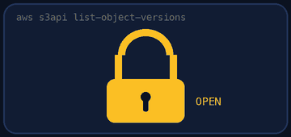
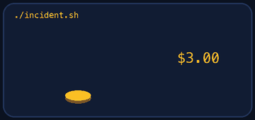
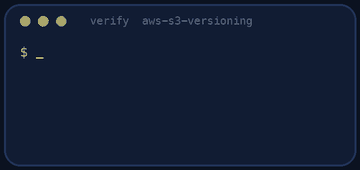
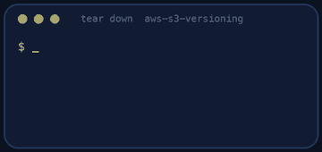

<p align="center"></p>

| | |
|-|-|
| **Time** | 60-75 min |
| **Cost** | free (S3 pennies) |
| **You need** | An AWS administrator user (the IAM lab), the AWS CLI v2 configured for it, Python 3 and a terminal |

## How this lab works

1. **Fork** this repository to your own GitHub account (button at the top right).
2. Clone **your fork** in your Ubuntu environment (WSL on Windows, your OrbStack machine on Mac).
3. Read the lab below (the same text is in [`LAB.md`](LAB.md)) and follow the mission.
4. Answer the questions in [`SUBMISSION.md`](SUBMISSION.md). Where a question asks for output, paste it in a code block. No screenshots needed.
5. Commit and push. Open the **Actions** tab of your fork (click *I understand my workflows, go ahead and enable them* the first time). The **Lab check** shows what is still missing.
6. When the check is green, **submit the URL of your fork** in the course platform.

> [!NOTE]
> The check only looks at your answers and any files the lab asks you to commit. Your instructor reads your work and may ask you to explain any line.

<p align="center"></p>

## 🎬 The situation

<p align="center"></p>

It is the first working day of the month. Somebody on the Clippy team ran a script against the wrong bucket: the monthly report was overwritten with garbage and the customer list was deleted. The finance team is waiting for the report and the CEO is asking how this is possible.

You are going to find out two things the hard way. First, **what S3 does by default** (and why it is not a backup). Second, what changes when you turn on **versioning**, and how you recover from the same accident, safely, the second time. Then you will set the rules that keep a versioned bucket from growing without limit.

> [!IMPORTANT]
> **Your mission**
> - Reproduce the accident on a bucket **without** versioning and prove the files are gone
> - Enable versioning, repeat the accident and recover both files from their history
> - Turn on default encryption, block public access, and add lifecycle rules for old versions and failed uploads
> - Tear it down (including every old version) and prove it

**Time:** 60-75 min | **Cost:** free (S3 pennies) | **You need:** an AWS administrator user, the AWS CLI v2 configured for it, Python 3 and a terminal.

<p align="center"></p>

## Part 0 - Set the scene

1. **Fork** this repository, clone it, and create the bucket with its two files:

```bash
./setup.sh
```

2. Look at the bucket in the **console** and with the CLI. What does it have and what does it not have?

```bash
B=clippy-reports-$(aws sts get-caller-identity --query Account --output text)
aws s3 ls s3://$B --recursive
aws s3api get-bucket-versioning --bucket $B
aws s3api list-object-versions --bucket $B
```

The versioning command prints nothing. Say in one sentence what that means. Notice that every object has the version id `null`.

<p align="center"></p>

## Part 1 - The accident, without a safety net

<p align="center"></p>

```bash
./incident.sh
```

Read what it did, then try everything you can think of to get the **original** report and the customer list back: the console, `list-object-versions`, "Show versions" in the console. Be honest about the result.

> [!NOTE]
> **Think** Deleting an object in a non-versioned bucket is permanent and an overwrite replaces the bytes. Which sentence on the S3 page of the AWS documentation would you show the CEO to explain why a bucket is not a backup?

<p align="center"></p>

## Part 2 - Turn on versioning, repeat the accident

1. Enable versioning (console: bucket → Properties → Bucket Versioning, or `aws s3api put-bucket-versioning`).
2. The finance team re-sends the two original files:

```bash
./setup.sh --reupload
```

3. Look at the versions of both files. Then the accident again:

```bash
./incident.sh
aws s3api list-object-versions --bucket $B
```

Read the output carefully. The report has several versions and one of them is the current one. The customer list **looks** deleted but is not: there is a **delete marker** on top of it.

> [!NOTE]
> **Think** The console shows the customer list as gone when "Show versions" is off, and as present when it is on. What exactly did `delete-object` write, and what is its version id?

<p align="center"></p>

## Part 3 - Recover (the safe way)

1. **The report.** Find the version id of the good version (the one that is not the garbage), and copy it over the current object. Do not delete the newest version:

```bash
aws s3api copy-object --bucket $B --key reports/2026-10.csv \
  --copy-source "$B/reports/2026-10.csv?versionId=<GOOD VERSION ID>"
```

2. **The customer list.** Delete the **delete marker** (a delete that names the marker's version id). The older version becomes current again.

3. Check the content of both files with `aws s3 cp s3://$B/<key> -`.

> [!NOTE]
> **Think** Copying the good version creates a *new* current version and keeps the garbage version in the history. Deleting the newest version would also "work". Why is the first one better when someone is investigating the accident?

<p align="center"></p>

## Part 4 - The rules that keep it safe and cheap

Versioning keeps everything. Without rules the bucket grows forever. Do all of these (console first, then find the CLI):

- **Default encryption**: SSE-S3 (AES256) with a bucket key.
- **Block public access**: all four options on.
- **A lifecycle rule** for the whole bucket: expire **noncurrent** versions after 90 days, and abort **incomplete multipart uploads** after 7 days.
- **Tag** the bucket `lab = aws-s3-versioning`.

Optional exploration: create a **presigned URL** for the report that works for 60 seconds, open it, wait, open it again.

```bash
aws s3 presign s3://$B/reports/2026-10.csv --expires-in 60
```

> [!NOTE]
> **Think** A presigned URL lets someone download a private object without any AWS account. Who pays for the traffic, and what happens if the person who signed it loses their own permission?

<p align="center"></p>

## Part 5 - Prove it

<p align="center"></p>

```bash
./verify.sh
```

It reads the real bucket: versioning, encryption, public access, lifecycle, the **content** of both files, and that the history contains the original, the garbage and your restored version. Fix what is red and run it again until it ends with **ALL CHECKS PASSED**.

> [!TIP]
> **Stuck?** `NoSuchKey` on copy: you used the wrong key or version id. `InvalidRequest: This copy request is illegal` happens when you copy an object onto itself without a version id. The lifecycle command needs a full JSON `--lifecycle-configuration` (use `file://rules.json` to avoid quoting problems).

<p align="center"></p>

## Level up (optional)

- Turn on **MFA delete** or **Object Lock** on a new bucket and explain what each prevents.
- Write a script `recover.sh <key>` that restores the newest non-garbage version of any object.
- Replicate the bucket to another region and compare the cost of replication with the cost of keeping 90 days of versions.

<!-- teardown:start (generated by labs.py, do not edit) -->
## Tear down (mandatory)

<p align="center"></p>

Resources left behind cost money, keep doors open and pollute the next lab. Removing what you created is part of the job, so it is part of the submission: **you must prove it is gone**.

Do this **last**, after you have pasted your `verify` output into `SUBMISSION.md` (once you tear down, the lab can no longer be verified).

1. Run `./teardown.sh`. It empties the bucket (all versions and delete markers) and deletes it. Then run `./verify-teardown.sh`.

Then run the proof:

```bash
./verify-teardown.sh
```

It prints a list of checks and must end with **TEARDOWN VERIFIED**. If it reports leftovers, remove them and run it again. Paste the full output in your submission.
<!-- teardown:end -->

<!-- submission:start (generated by labs.py, do not edit) -->
## 📬 Submission

Answer the questions in `SUBMISSION.md` in **your fork** (paste output in code blocks where asked), push, then submit the **URL of your fork**.

**Files to commit**

- `notes.md` with your commands and what you saw (optional)

**Questions to answer**

1. After the first `./incident.sh` (no versioning), paste the proof that the report and the customer list could not be recovered. What would have saved them?
2. After the second incident, paste `aws s3api list-object-versions` for both files. What is a delete marker and why does a deleted file still exist?
3. Show the exact commands that restored the report and the customer list. Why restore by copying the old version to the current key instead of deleting the newest version?
4. Paste your lifecycle rules. After one year, what happens to the old versions and to the incomplete multipart uploads, and what would the bucket cost without them?
5. Default encryption is on (SSE-S3). When would you use SSE-KMS with your own key instead, and what extra failure can it introduce?
6. Paste the output of `./verify.sh`. It must end with **ALL CHECKS PASSED**.
7. **Tear down.** Paste the output of `./verify-teardown.sh`. It must end with **TEARDOWN VERIFIED**.
<!-- submission:end -->
